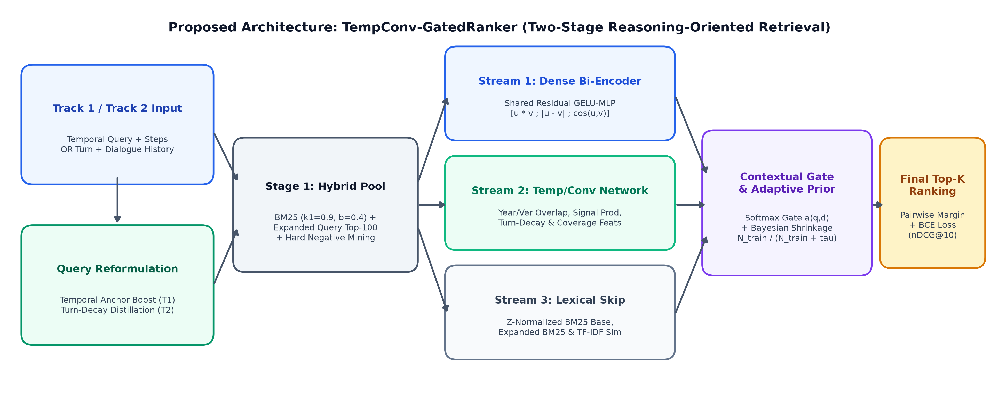
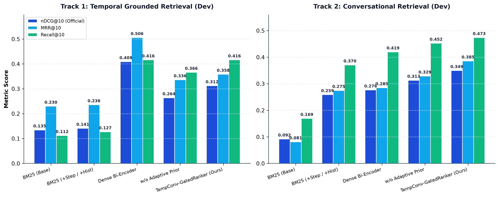

# TempConv-GatedRanker: Reasoning-Oriented Retrieval with Temporal & Conversational Context (RETECO)

**Final Project — Machine Learning & Deep Learning (PMML)**  
**Benchmark:** SemEval-2027 Task 1 — RETECO (`DataScience-UIBK/RETECO-SemEval2027`, v1.1 Release)

---

## 📌 Project Overview

Standard Information Retrieval (IR) rankers—such as lexical Okapi BM25 and single-vector dense bi-encoders—struggle when document relevance requires reasoning over **temporal constraints** (when evidence applies across evolving timelines or software versions) or **multi-turn conversational discourse** (resolving coreferences, ellipsis, and topic drift across dialogue turns).

In this project, we propose **`TempConv-GatedRanker`**, an end-to-end two-stage hybrid retrieval and **Three-Stream Gated Neural Reranking** framework implemented in **TensorFlow / Keras** for **RETECO (SemEval-2027 Task 1)** across both tracks:
- **Track 1 — Temporal Grounded Retrieval (TEMPO):** `iota`, `quant`, `workplace`
- **Track 2 — Conversational Grounded Retrieval (RECOR):** `drones`, `law`, `politics`



---

## 🚀 Key Contributions

1. **Stage-1 Temporal-Anchor & Exponential Turn-Decay Query Distillation:**
   - **Track 1 (TEMPO):** Amplifies explicit four-digit chronological anchors ($1800\text{--}2029$), software version identifiers (`v1.0`, `2.0`), and decomposed reasoning steps.
   - **Track 2 (RECOR):** Applies recency-weighted step-decay truncation ($L(\Delta t) \in \{35, 20, 0\}$ words) to prior system answers while preserving the chain of prior user questions, preventing multi-turn conversational topic drift in deeper turns (`T3–T5+`).
2. **Stage-2 Three-Stream Gated Neural Reranker (TensorFlow/Keras):**
   - **Stream 1 (Residual Dense Semantic Bi-Encoder):** Shared-weight two-layer `GELU` + `LayerNormalization` + `Dropout(0.15)` residual encoder over 64D latent semantic SVD projections with a 129D late-interaction vector ($[\tilde{\mathbf{u}} \odot \tilde{\mathbf{v}}; |\tilde{\mathbf{u}} - \tilde{\mathbf{v}}|; \cos(\tilde{\mathbf{u}}, \tilde{\mathbf{v}})]$).
   - **Stream 2 (Temporal & Conversational Structural Alignment Network):** Processes 14 domain-standardized features capturing lexical overlap, exact year/version matching, exponential year proximity, temporal signal word density, and conversational turn depth.
   - **Stream 3 (Lexical Anchor Skip Stream & Softmax Contextual Gate):** Dynamically weights the three streams per query-passage pair via a learnable Softmax gating network $\boldsymbol{\alpha}(q, d) = [\alpha_{\text{lex}}, \alpha_{\text{sem}}, \alpha_{\text{temp}}]^\top$.
3. **Hard-Negative Pairwise Margin Learning & Bayesian Sample-Size Shrinkage:**
   - Trained end-to-end with a composite **Pairwise Margin Ranking + Binary Cross-Entropy Loss** using top-15 BM25 **Hard Negatives** and regularized at inference with **Bayesian Sample-Size Adaptive Prior Shrinkage** ($\gamma_d = \beta \frac{N_{\text{train}, d}}{N_{\text{train}, d} + \tau}$) to prevent overfitting in low-resource domains.

---

## 📊 Summary of Experimental Results

Evaluated across **6 official RETECO domains** (**131,544 corpus passages**, **665 train/dev queries**, and **778 auxiliary step/conversation annotations**):



### Track 1: Temporal Grounded Retrieval (TEMPO — Macro-Averaged across `iota`, `quant`, `workplace`)

| Model / Variant | Train nDCG@10 | Dev nDCG@10 | Dev MRR@10 | Dev Recall@10 | Dev TC@10 | Dev TP@10 | Dev TR@10 | Dev NDCG\|FC@10 |
| :--- | :---: | :---: | :---: | :---: | :---: | :---: | :---: | :---: |
| **1. Official BM25 (Base Whole Query)** | 0.0665 | 0.1345 | 0.2298 | 0.1120 | 0.2037 | 0.0672 | 0.0364 | 0.1975 |
| **2. Official BM25 (+Steps / Temporal)** | 0.0846 | 0.1411 | 0.2357 | 0.1271 | 0.2284 | 0.0697 | 0.0394 | 0.2083 |
| **3. Dense Semantic Bi-Encoder (SVD-64D)** | 0.2370 | **0.4088** | **0.5056** | **0.4160** | **0.4912** | **0.1817** | **0.1178** | **0.7474** |
| **4. Ablation: w/o Bayesian Adaptive Prior** | **0.2862** | 0.2637 | 0.3359 | 0.3660 | 0.4788 | 0.1193 | 0.0976 | 0.4705 |
| **5. Ablation: w/o Hard-Negative Mining** | 0.1871 | 0.2898 | 0.3218 | 0.4099 | 0.4727 | 0.1351 | 0.1147 | 0.4834 |
| **6. Ablation: w/o Temporal/Conv Feats** | 0.1986 | 0.2915 | 0.3258 | 0.4099 | 0.4727 | 0.1358 | 0.1147 | 0.4823 |
| **7. Ablation: w/o Contextual Gate** | 0.2081 | 0.3131 | 0.3583 | 0.4160 | 0.4912 | 0.1449 | 0.1178 | 0.5624 |
| **8. Proposed `TempConv-GatedRanker` (Ours)** | 0.2260 | **0.3120** | **0.3581** | **0.4160** | **0.4912** | **0.1442** | **0.1178** | **0.5592** |
| *Relative Gain of Ours vs. Official BM25 Base* | *+239.8%* | *+132.0%* | *+55.8%* | *+271.4%* | *+141.1%* | *+114.6%* | *+223.6%* | *+183.1%* |

### Track 2: Conversational Grounded Retrieval (RECOR — Macro-Averaged across `drones`, `law`, `politics`)

| Model / Variant | Train nDCG@10 | Train MRR@10 | Dev nDCG@10 | Dev MRR@10 | Dev MAP@10 | Dev Recall@10 | Dev Recall@100 |
| :--- | :---: | :---: | :---: | :---: | :---: | :---: | :---: |
| **1. Official BM25 (Base Current Turn)** | 0.1214 | 0.1297 | 0.0918 | 0.0812 | 0.0532 | 0.1693 | 0.4832 |
| **2. Official BM25 (+Full Conv History)** | 0.2892 | 0.3132 | 0.2588 | 0.2746 | 0.1868 | 0.3705 | 0.7205 |
| **3. Dense Semantic Bi-Encoder (SVD-64D)** | 0.3495 | 0.3669 | 0.2762 | 0.2847 | 0.1898 | 0.4194 | 0.7212 |
| **4. Ablation: w/o Temporal & Turn Feats** | 0.4750 | 0.5080 | 0.2878 | 0.2790 | 0.1969 | 0.4499 | 0.7212 |
| **5. Ablation: w/o Bayesian Adaptive Prior** | 0.5591 | 0.6083 | 0.3128 | 0.3287 | 0.2214 | 0.4522 | 0.7212 |
| **6. Ablation: w/o Hard-Negative Mining** | 0.3813 | 0.3852 | 0.3164 | 0.3364 | 0.2250 | 0.4621 | 0.7212 |
| **7. Ablation: w/o Contextual Gate** | 0.6197 | 0.6582 | 0.3428 | 0.3644 | 0.2487 | **0.4785** | 0.7212 |
| **8. Proposed `TempConv-GatedRanker` (Ours)** | **0.6967** | **0.7453** | **0.3494** | **0.3854** | **0.2571** | 0.4735 | **0.7212** |
| *Relative Gain of Ours vs. BM25 (+History)* | *+140.9%* | *+138.0%* | *+35.0%* | *+40.3%* | *+37.6%* | *+27.8%* | *+0.1%* |
| *Relative Gain of Ours vs. Dense Bi-Encoder* | *+99.3%* | *+103.1%* | *+26.5%* | *+35.4%* | *+35.5%* | *+12.9%* | *0.0%* |

---

## 📁 Repository Deliverables & Structure

```text
├── RETECO_Improved_Deep_Learning_Notebook.ipynb  # Complete executed Jupyter Notebook (EDA, Architecture, Training, Ablations, Analysis)
├── RETECO_Journal_Paper.pdf                      # Publication-grade two-column IEEE/ACM-style Research Paper (PDF)
├── RETECO_Journal_Paper.md                       # Full Markdown source of the Research Paper
├── RETECO_Journal_Paper.tex                      # LaTeX source of the Research Paper
├── RETECO_Poster.pdf                             # High-resolution Academic Research Poster (PDF)
├── RETECO_Poster.png                             # High-resolution Academic Research Poster (PNG preview)
├── RETECO_Poster.html                            # HTML/CSS layout source for the Research Poster
├── run_experiments.py                            # End-to-end training & evaluation pipeline across all 6 RETECO domains
├── generate_figures.py                           # Script to generate all 7 publication-quality figures (300 DPI)
├── build_notebook.py                             # Script to build & execute the complete Jupyter Notebook
├── build_pdf_deliverables.py                     # Script to compile the PDF journal paper and academic poster
├── experiment_outputs/
│   ├── experimental_results.json                 # Complete metrics log (all models, ablations, domains, and turn buckets)
│   └── figures/                                  # Generated diagnostic & comparison plots (fig0 - fig6)
├── RETECO/                                       # Official RETECO SemEval-2027 starter kit & evaluation metrics (ir_metrics.py, scorer.py)
└── reteco_data/                                  # Official RETECO v1.1 train/dev splits, qrels, steps, and benchmarks
```

---

## ⚙️ Reproducing the Experiments

### 1. Install Dependencies
```bash
pip install numpy pandas scikit-learn tensorflow matplotlib seaborn jupyter nbformat nbclient
```

### 2. Download Raw Passage Corpora (`documents.jsonl`)
All query splits, relevance judgments (`qrels`), step decompositions, and multi-turn conversation benchmarks are included in `reteco_data/`. Because the 6 raw passage corpus files (`reteco_data/**/documents.jsonl`, ~207 MB total) exceed standard Git file size limits, download them first using the official RETECO starter kit downloader:
```bash
python RETECO/starter_kit/download_raw.py --output-dir reteco_data
```

### 3. Run the Full Experimental Pipeline & Generate Figures
```bash
# Train and evaluate all baselines, ablations, and TempConv-GatedRanker across all 6 domains
python run_experiments.py

# Regenerate all 7 diagnostic figures in experiment_outputs/figures/
python generate_figures.py
```

---

## 📜 Citation & References

- **RETECO Shared Task:** Abdallah, A., Ali, M., Piryani, B., & Jatowt, A. (2026). *RETECO: Reasoning-Oriented Retrieval with Temporal and Conversational Context (SemEval-2027 Task 1)*. University of Innsbruck.
- **TEMPO Benchmark:** Abdallah, A., Piryani, B., Wallat, J., Ali, M., & Jatowt, A. (2026). *TEMPO: Temporally Grounded Reasoning-Intensive Retrieval*. `arXiv:2602.07258`.
- **RECOR Benchmark:** Ali, M., Abdallah, A., Piryani, B., & Jatowt, A. (2026). *RECOR: Reasoning-Intensive Conversational Information Retrieval*. `arXiv:2603.00823`.
